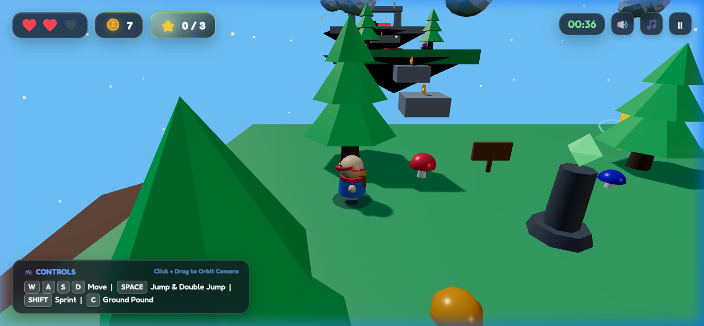

# 🌟 Super Star Hopper: Low-Poly 3D Adventure

<p align="center">
  
</p>

<p align="center">
  <strong>A vibrant 3D low-poly platformer adventure inspired by Super Mario 64, built with Three.js and Vite.</strong>
</p>

<p align="center">
  
  
  
  
  
  
</p>

---

## 🎮 Overview

**Super Star Hopper** is a responsive, fast-paced 3D platformer running directly in the browser. You play as a curious low-poly explorer venturing across floating sky islands, dodging hazard beams, stomping purple slime monsters, collecting spinning gold coins, and retrieving the 3 Grand Power Stars to reach the Summit Altar.

---

## ✨ Features

- 🏃 **Responsive Platformer Controller**:
  - Smooth acceleration, deceleration, and camera-relative directional movement.
  - Variable jump height with **coyote time** and jump buffering.
  - **Double Jump** with an acrobatic front-flip somersault.
  - **Ground Pound Slam** with downward shockwave dust bursts.
  - Dynamic squash-and-stretch body deformation on landings and bounces.
  - Ground-projected dynamic drop-shadow that scales with jump altitude.

- 🏝️ **Hand-Crafted Sky Island World**:
  - **Emerald Meadow (Spawn)**: Lush starter island with pine trees, spotted mushrooms, and a crystal checkpoint totem.
  - **Bouncing Meadow**: Oscillating stepping stone bridges and super-springy bouncy mushrooms.
  - **Ancient Wind Ruins**: Grand stone pillars, high sky arches, and rotating hazard beams.
  - **Crystal Chasm**: Elevating cloud lifts and floating puffy cloud stepping stones.
  - **Summit Shrine (Starlight Temple)**: Apex of the floating world containing the Grand Summit Power Star!

- 👾 **Enemy AI & Stomp Combat**:
  - Patrolling purple slime creatures ("Blobbies") with animated bouncy walk cycles.
  - **Mario-style Stomp Mechanic**: Jump on top of enemies to squash them flat, trigger a particle explosion, gain a rebound bounce, and spawn bonus coins!
  - Side collisions trigger knockback with an invulnerability flash period.

- 🪙 **Collectibles & Objectives**:
  - **30+ Spinning Gold Coins**: Equipped with soft magnetic attraction that draws them towards the player.
  - **3 Grand Power Stars**: Hidden across challenge platforms with orbiting aura rings.
  - **Health Heart Pickups**: Restores lost heart containers.

- 🎵 **Procedural Web Audio Engine**:
  - Zero external `.mp3` or `.wav` dependencies! 100% generated in real time using the **Web Audio API**.
  - Retro 16-bit sound effects (jumps, double jumps, pentatonic coin arpeggios, enemy stomp pops, checkpoint jingles, and victory fanfare).
  - Built-in cheerful 8-bar melodic soundtrack synthesizer.

- 📱 **Glassmorphic HUD & Mobile Touch Support**:
  - Floating frosted-glass HUD showing hearts, coin counter, star badges, and speedrun timer.
  - On-screen virtual joystick and touch action buttons for seamless mobile/tablet gameplay.
  - Integrated Pause menu (<kbd>ESC</kbd>) and Victory Celebration modal with run grade (S / A / B) and statistics.

---

## 🕹️ Controls

| Action | Keyboard / Mouse | Touch Controls |
| :--- | :--- | :--- |
| **Move** | <kbd>W</kbd> <kbd>A</kbd> <kbd>S</kbd> <kbd>D</kbd> or <kbd>Arrow Keys</kbd> | Virtual Touch Joystick |
| **Jump** | <kbd>Space</kbd> | Tap **▲** Button |
| **Double Jump** | <kbd>Space</kbd> (in mid-air) | Double Tap **▲** Button |
| **Ground Pound** | <kbd>C</kbd> or <kbd>Ctrl</kbd> (in mid-air) | Tap **⬇** Button |
| **Sprint** | Hold <kbd>Shift</kbd> | Extend joystick radius |
| **Orbit Camera** | Left/Right Click + Drag Mouse | Drag across screen |
| **Rotate Camera** | <kbd>Q</kbd> / <kbd>E</kbd> | Drag gesture |
| **Zoom Camera** | Mouse Scroll Wheel | Pinch / Scroll |
| **Pause Game** | <kbd>ESC</kbd> or Pause button | Tap ⏸ button |

---

## 🏗️ Project Architecture

```
game/
├── electron/
│   └── main.cjs                  # Electron main process & desktop window lifecycle
├── public/
│   └── screenshots/
│       └── gameplay.png          # High-resolution gameplay preview
├── src/
│   ├── audio.js                  # Web Audio API sound synthesizer & BGM engine
│   ├── camera.js                 # 3rd-person orbital camera with clipping prevention
│   ├── collectibles.js           # Magnetic coins, Grand Power Stars, health hearts
│   ├── enemies.js                # Slime AI, stomp mechanics, and death particles
│   ├── main.js                   # Three.js WebGL renderer, ACES tone mapping & game loop
│   ├── player.js                 # Character model, physics, state machine & animations
│   ├── style.css                 # Glassmorphic HUD, typography, and responsive styles
│   ├── ui.js                     # DOM overlays, input handlers, virtual joystick & modals
│   └── world.js                  # Procedural floating islands, platforms & lighting
├── index.html                    # Application entrypoint & SEO meta tags
├── vite.config.js                # Vite build config with relative base for Electron
├── package.json                  # Dependencies & npm scripts
└── README.md                     # Project documentation
```

---

## 🚀 Getting Started

### Prerequisites

- [Node.js](https://nodejs.org/) (version 18 or higher recommended)
- [npm](https://www.npmjs.com/) or [pnpm](https://pnpm.io/)

### Installation

1. **Clone the repository**:
   ```bash
   git clone https://github.com/Segn11/low-poly-3d-adventure.git
   cd low-poly-3d-adventure
   ```

2. **Install dependencies**:
   ```bash
   npm install
   ```

---

### 🌐 Running in the Web Browser

- **Start Vite Dev Server**:
  ```bash
  npm run dev
  ```
  Open **`http://localhost:5173/`** in any browser.

- **Build Production Web Bundle**:
  ```bash
  npm run build
  ```
  The production assets are generated in `dist/`.

---

### 🖥️ Running as a Desktop App (Electron)

You can launch and package the game natively for desktop without any web browser needed:

1. **Launch Desktop App in Dev Mode** (with hot reload):
   ```bash
   npm run app:dev
   ```

2. **Run Built Desktop App Locally**:
   ```bash
   npm run app:start
   ```

3. **Package Standalone Windows `.exe` Installer & Portable App**:
   ```bash
   npm run app:build
   ```
   *Generates Windows installer and portable `.exe` in the `release/` folder.*

4. **Generate Portable `.exe` Only**:
   ```bash
   npm run app:build:portable
   ```

---

## ⚡ Performance Highlights

- **Antialiased WebGL Renderer**: Configured with `ACESFilmicToneMapping` for vibrant, cinematic color reproduction.
- **Low-Poly Primitives**: Built entirely from geometric Three.js meshes with flat shading, minimizing memory bandwidth.
- **Physics Capping**: Delta time capped at 50ms to prevent tunneling during background tab switching or frame hitches.
- **Instant Boot Time**: No large 3D asset bundles (.gltf / textures) to download—starts rendering in under 300ms!

---

## 📄 License

This project is licensed under the [MIT License](LICENSE). Feel free to build upon, modify, and create your own stages!
